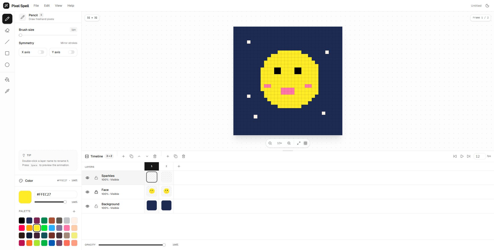

# Pixel Spell

A focused pixel art editor that runs entirely in the browser. Draw sprites, build layered artwork, and animate frame by frame with a clean, modern interface.



## Features

- **Drawing tools** — pencil, spray, eraser, line, curve, rectangle, ellipse, paint bucket, and eyedropper, plus pan and pointer-focused zoom tools. Zooming with the tool or the scroll wheel moves the view halfway from the current center toward the pointer. The curve tool starts with a dragged base line, then two clicks place its control points. The spray tool scatters random pixels inside a round area at an adjustable pixel rate.
- **Area effects** — the blur and jumble tools soften or scramble pixels inside a round area as you pass over them, with adjustable radius and power.
- **Selections** — magic wand (with optional diagonal connections), separate rectangle and ellipse marquee tools, freehand or polygonal lasso, and select-by-color. Drag inside a selection to move its pixels; hold `Shift` while making another selection to add it to the current one. Edits are clipped to the selected area, and `Delete` clears the selected pixels. Deselect with the panel button or `Esc`.
- **Tool options** — brush sizes from 1–8 px, filled shapes, fill tolerance and contiguous fill, layer-aware color sampling, and selection options. The top bar's alpha-lock toggle prevents painting over fully transparent pixels.
- **Pixel perfect** — optional corner-pixel removal for smoother pencil, eraser, and curve strokes.
- **Mirroring** — X, Y, and two diagonal axis mirrors. X mirrors across the horizontal axis and Y across the vertical axis. Active axes are drawn as dashed blue lines across the whole canvas stage and can be dragged from anywhere on the stage; drag a line in half-pixel steps to move its mirror axis. Turning a mirror off resets its guide to the center. The toggles live in the top bar next to the theme switch.
- **Aseprite-style timeline** — layers are rows and frames are columns. Click any cel to select its layer and frame; sticky headers keep both axes visible while scrolling. Add, duplicate, reorder, rename, hide, lock, delete, and adjust layer opacity; add, duplicate, and delete frames; play the animation at 1–60 fps.
- **Resizable workspace** — drag the divider above the timeline, or focus it and use `↑` / `↓`, to resize the canvas/timeline split. The height is remembered between visits.
- **Color workflow** — separate primary (left mouse) and secondary (right mouse) colors with an always-visible saturation/brightness picker, hue and alpha sliders, hex input, and a 32-color palette you can extend. Left-click a palette swatch to set the primary color; right-click to set the secondary. A swap button between the two swatches exchanges them.
- **History** — 80-step undo/redo stack per project, with keyboard shortcuts.
- **Export** — current frame as PNG, or every frame as a horizontal sprite sheet.
- **Multiple projects** — open several projects in tabs above the canvas. Each tab keeps its own document, history, zoom, pan, and unsaved state. Closing a dirty project asks for confirmation; closing the last project starts a new untitled one.
- **Projects** — save and open portable `.pixelspell.json` files; opened files get their own tab.
- **Canvas controls** — fit-to-window or manual zoom, scroll-wheel zoom, middle-mouse panning that always keeps part of the sprite on stage, pixel grid, and a live cursor preview. A compact menu-bar readout shows the canvas size, last cursor coordinate, current frame, and active layer.
- **Preview window** — a 1× copy of the active frame floats in the upper-right of the canvas stage. Close it to leave a circular scan-eye button; toggle it from **View → Show preview**. The preview updates while the animation plays.
- **Light and dark themes** with a sky-blue accent, persisted in `localStorage`.

## Tech stack

- [Svelte 5](https://svelte.dev/) with runes
- [Vite](https://vite.dev/) + TypeScript
- [Tailwind CSS 4](https://tailwindcss.com/)
- [shadcn-svelte](https://shadcn-svelte.com/) (Nova preset) and [bits-ui](https://bits-ui.com/)
- [Lucide](https://lucide.dev/) icons

## Getting started

Requires Node.js 22 or newer.

```bash
npm install
npm run dev
```

Open the URL printed by Vite (usually `http://localhost:5173`).

### Scripts

| Command           | Description                                  |
| ----------------- | -------------------------------------------- |
| `npm run dev`     | Start the Vite dev server                    |
| `npm run build`   | Build for production                          |
| `npm run preview` | Preview the production build locally         |
| `npm run check`   | Run `svelte-check` and TypeScript validation |

## Keyboard shortcuts

| Action              | Shortcut                 |
| ------------------- | ------------------------ |
| Pan                 | `H`                      |
| Zoom                | `Z`                      |
| Magic wand          | `W`                      |
| Rectangle select    | `M`                      |
| Ellipse select      | `Shift+M`                |
| Lasso               | `Q`                      |
| Select by color     | `C`                      |
| Pencil              | `B`                      |
| Spray               | `S`                      |
| Eraser              | `E`                      |
| Line                | `L`                      |
| Curve               | `U`                      |
| Rectangle           | `R`                      |
| Ellipse             | `O`                      |
| Fill                | `G`                      |
| Eyedropper          | `I`                      |
| Blur                | `K`                      |
| Jumble              | `J`                      |
| Undo / redo         | `Ctrl+Z` / `Ctrl+Shift+Z` |
| New sprite          | `Ctrl+N`                 |
| Save project        | `Ctrl+S`                 |
| Play / pause        | `Space`                  |
| Previous / next frame | `[` / `]` or `,` / `.`  |
| Toggle pixel grid   | `Shift+G`                |
| Select all          | `Ctrl+A`                 |
| Delete selection    | `Delete`                 |
| Deselect            | `Esc`                    |
| Resize timeline     | Drag divider, or `↑` / `↓` |

Shortcuts are ignored while typing in an input. The Help menu also lists them.

## Project structure

```
src/
├── App.svelte                  # App shell, layout, global shortcuts
├── app.css                     # Tailwind, shadcn theme, editor surface styles
└── lib/
    ├── components/
    │   ├── editor/             # Menu bar, tool strip, tool/color panels, canvas, timeline, dialogs
    │   └── ui/                 # shadcn-svelte components
    └── editor/
        ├── editor.svelte.ts    # Reactive editor state (Svelte 5 runes)
        ├── types.ts            # Document, layer, frame, and tool types
        ├── doc.ts              # Document creation, cloning, compositing
        ├── draw.ts             # Brush, line, shape, and fill algorithms
        ├── render.ts           # Canvas and thumbnail rendering helpers
        ├── color.ts            # Packed RGBA and hex color utilities
        ├── file.ts             # PNG export and project serialization
        ├── palette.ts          # Default palette
        └── tools.ts            # Tool metadata and shortcuts
```

The project tab strip lives in `components/editor/ProjectTabs.svelte`; the editor core keeps one session per project in `editor.svelte.ts`.

## Data model

A document is a `PixelDoc`:

- `width`, `height`, `fps`
- `frames[]` — animation frames
- `layers[]` — ordered bottom-to-top; each layer has visibility, opacity, lock state, and one `Uint32Array` cel per frame

Pixels are packed little-endian RGBA (`0xAABBGGRR`), which lets cels be written directly into `ImageData` for rendering and PNG export. Transparent pixels are `0`.

Project files store each cel as a base64 string, so they are portable between browsers and easy to inspect.

Each open project is a separate `PixelDoc` session with its own active layer/frame, zoom, pan, undo history, and dirty state. Tool, color, palette, theme, and timeline-height settings are shared across the workspace.

## Notes and limitations

- Open project tabs are kept in memory; reloading the page starts with a single new `Untitled` project.
- Each tab shows an unsaved dot when it has unsaved progress. Closing a dirty project asks for confirmation, and the close button is disabled for a single untouched project.
- **File → New sprite** and **File → Open project** create new tabs; **File → Save project** saves the active project.
- The timeline is an Aseprite-style grid: layer rows and frame columns, with sticky headers and cel thumbnails. Its height is remembered in `localStorage`.
- Layer visibility and opacity are document-wide rather than per-frame.
- Brushes are square and pixel-aligned; there is no selection or move tool yet.
- The editor does not auto-save. Use **File → Save project** to keep your work.
- The default canvas is 32 × 32; new sprites can be 1–256 px in each dimension.
